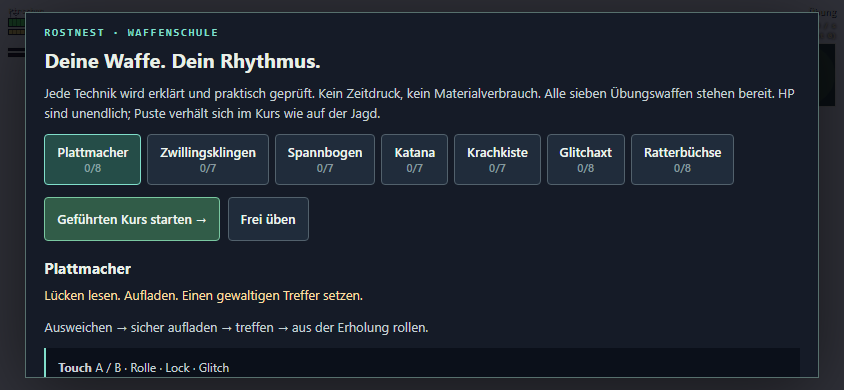
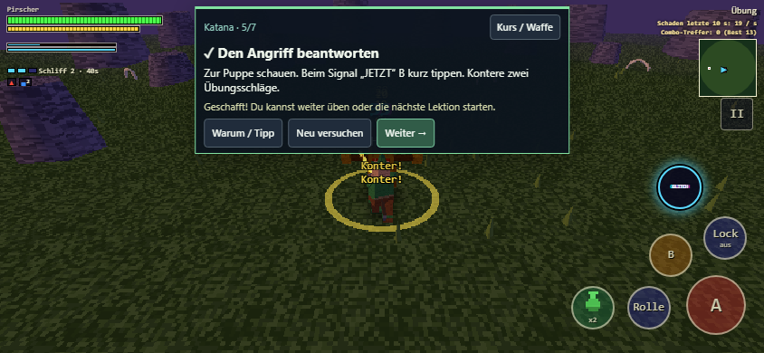
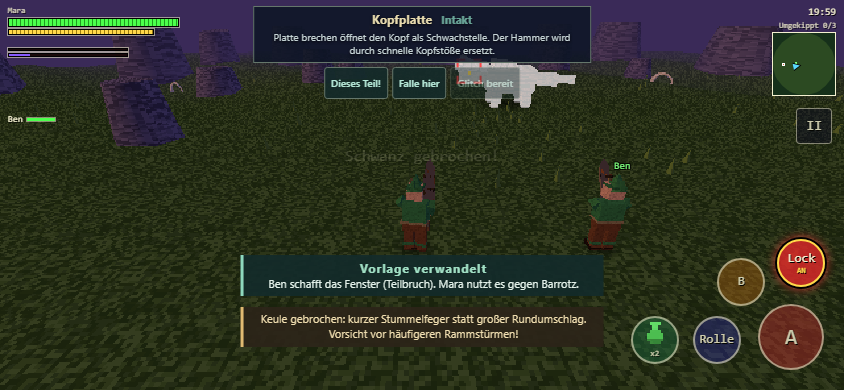

# Waffenschule, Koop-Momente und taktische Teilbrüche

## Waffenschule am Übungsplatz

Im Rostnest die **Trainingspuppe** ansprechen. Der Übungsplatz öffnet direkt die Waffenschule. Alle sieben Waffen können unabhängig vom eigenen Fortschritt als Stufe-1-Übungswaffen ausprobiert werden. Die ausgerüstete Waffe und der Materialbestand im Spielstand werden dadurch nicht verändert.

Jeder Kurs erklärt zuerst Spielidee und Rhythmus. Danach wird jeweils **eine Aufgabe** gestellt und die tatsächliche Ausführung geprüft. Gelungene Schritte werden lokal gespeichert. Spieler wählen selbst „Weiter“, wiederholen einzelne Lektionen oder wechseln ins freie Training. Ein „Warum / Tipp“-Knopf erklärt den taktischen Zweck.

| Waffe | Praktische Lektionen |
|---|---|
| Plattmacher | Lock/Abstand, perfekte Rolle, Dreierkette, sauber aufladen, frontal blocken, Rempler → Ladung, Schrottbrecher, Frame-Skip |
| Zwillingsklingen | Lock/Abstand, perfekte Rolle, Schnittkette, Rausch-Treffer, Rolle → Sprungschnitt, Schrottwirbel, Echo-Input |
| Spannbogen | Lock/Abstand, perfekte Rolle, Treffer auf optimale Distanz, Durchschuss Stufe 3, Ausweichspannen, Pfeilregen, Debug-Modus |
| Katana | Lock/Abstand, perfekte Rolle, Schnittkette, sauberer Ziehschnitt, zwei echte Konter, Mondsichel, Desync-Schnitte |
| Krachkiste | Lock/Abstand, perfekte Rolle, Samples sammeln, Beat abspielen, sauberer Stampfer, Zugabe, Feedback-Schleife |
| Glitchaxt | Lock/Abstand, perfekte Rolle, Druck sammeln, Schwert-Treffer, sauber zurückschalten, Entladung, Kernschmelze, Zustandsfehler |
| Ratterbüchse | Lock/Abstand, perfekte Rolle, Rattern, sauberes Nachladen, Mine, Ausfallschritt → Hüpfschuss, Rückstoß-Kracher, Buffer Overflow |

**52 Lektionen insgesamt.** HP sind im Training unendlich. Im Kurs verhält sich Puste normal; „Neu versuchen“ setzt die Ausgangslage zurück. Wucht wird nur für die Finisher-Lektion voll bereitgestellt, damit B bei anderen Übungen seine normale Funktion behält. Glitch-Energie lädt automatisch. Im freien Training füllen sich auch Puste und Wucht automatisch.

Die Verteidigungsübungen markieren einen Schlag am Boden und kündigen ihn mit Ton und Countdown an. Block, Katana-Konter und perfekte Rolle laufen durch dieselbe Trefferbehandlung wie in der Jagd.

## Gemeinsame Koop-Momente

Das System würdigt konkrete Zusammenarbeit während des normalen Kampfes:

- **Vorlage verwandelt:** Einer bricht ein Teil, betäubt den Brocken, fängt ihn mit einer Klebefalle oder holt ihn per Blendknolle aus dem Flug. Ein anderer nutzt das noch offene Fenster mit tatsächlichen Treffern. Der Bericht nennt beide.
- **Rettung in letzter Sekunde:** Ein Teilbruch unterbricht einen laufenden Angriff auf einen Mitspieler mit weniger als 30 % HP.
- **Im selben Takt:** Ein Krachkisten-Spieler stärkt einen nahen Mitspieler mit einem Angriffs-Beat; dieser setzt danach Treffer gegen den Brocken.

Die Fenster richten sich nach der bestehenden Dauer: Teilbruch 2 s, Betäubung/Falle 6 s, Flugsturz 4 s. Eigene Folgetreffer, Umgebungsschaden, abgelaufene Fenster und rein vorhergesagte Gasttreffer erzeugen keine Auszeichnung. Ein Fenster wird höchstens einmal gewürdigt. Kleine Einzel-Treffer reichen nicht; die Schadensschwelle skaliert mit dem Brocken.

Der Host entscheidet und überträgt das Ergebnis an die Gäste. Die letzten zwölf gemeinsamen Momente erscheinen im Ergebnisbildschirm unter **„Gemeinsam geschafft“**. Das System erhöht keinen Schaden und verlängert keine Betäubung.

**Drei schnelle Signale:** „Dieses Teil!“ markiert das gelockte Körperteil für alle, „Falle hier“ markiert den Standort des Senders, „Glitch bereit“ kündigt eine volle Leiste an. Eine frisch volle Glitch-Leiste wird einmal automatisch angekündigt. Signale sind auf eines pro Spieler und vier Sekunden begrenzt; im Solo werden sie ausgeblendet.

## Teilbrüche als Jagdplan

Beim Lock zeigt eine kompakte Karte den Zustand des ausgewählten Teils: **intakt → angeschlagen → kurz vor Bruch → gebrochen/abgetrennt**. Sie erklärt bereits vor dem Bruch den taktischen Nutzen und die Gegenreaktion. Nach einem Bruch erscheint die Konsequenz nochmals als Hinweis. Im Kompendium stehen dieselben Teilbruch-Pläne bei den Schwachstellen bereits bekannter Brocken.

Neue Kampfänderungen:

- **Barrotz, Keule:** Der große Feger wird durch einen kürzeren Stummelfeger mit eigener passender Bodenmarkierung und Trefferzone ersetzt. Die äußere Gefahrenzone entfällt. Dafür steigt das Auswahlgewicht des Rammsturms von 4 auf 7. Beide Feger sind durch den Bruchzustand gegenseitig gesperrt.
- **Brathalos, Kopf:** Der Rotglut-Feuerfächer wird zum geraden Einzelschuss. Dafür steigt das Auswahlgewicht des Feuerteppichs von 3 auf 6.

Vorhandene Konsequenzen werden sichtbar erklärt, etwa Jaggo-Schwanzbruch → keine Wirbel/Rückhüpfer, dafür mehr Zickzack-Bisse; Barrotz-Kopfbruch → weicher Kopf, dafür Kopfstoßketten; Brathalos-Flügelbruch → dauerhaft am Boden, dafür Flammenstoß; Kroll-Panzerbruch → Phase 2; Voltaro-Kammbruch → Überladung unterbrechen. Für weitere Teile werden die tatsächlichen Angriffssperren aus den Monsterdaten gelesen.

## Validierung

- Produktionsbuild erfolgreich.
- Neue Unit-Tests für Kursziele, echte Finisher-Eingaben, Puste/Wucht im Kurs, Fensterzuordnung, Ablaufzeiten, Solo/Gast-Ausschluss, Deduplizierung, Signale und Teilbruchdaten.
- Bestehende Kampf-, Waffen- und Netzwerkprüfungen durchgeführt. Der bisherige Test mit fest acht Barrotz-Angriffen wurde auf neun aktualisiert; der zusätzliche Angriff ist der Stummelfeger.
- Fairnessprüfung für den Stummelfeger: Ankündigung mindestens 0,5 s, mit einer gut getimten Rolle ausweichbar, Ausweichfenster mindestens 100 ms. Host und Gast berechnen dieselben Trefferzonen aus den Startparametern.
- `tools/learning-coop-e2e.mjs`: **56 Browser-Prüfungen**, darunter alle 52 Kursziele mit tatsächlichen Eingaben, unveränderter Spielstand, echte Katana-Konter und Nachladefenster. Zwei HuntNet-Instanzen prüfen Gasttreffer → Hostauswertung → identische Gastanzeige über einen serialisierten Testtransport. Ereignisse eines fremden Senders werden verworfen.
- Ansichten bei 844 × 390 und 1280 × 720 geprüft; keine Browser-Laufzeitfehler.

Der lokale Netztest ersetzt keinen Verbindungstest auf sechs physischen Handys. Beim nächsten gemeinsamen Handytest besonders Lesbarkeit der Hinweise, Signalfrequenz und das gefühlte Tempo nach Teilbrüchen beurteilen.
